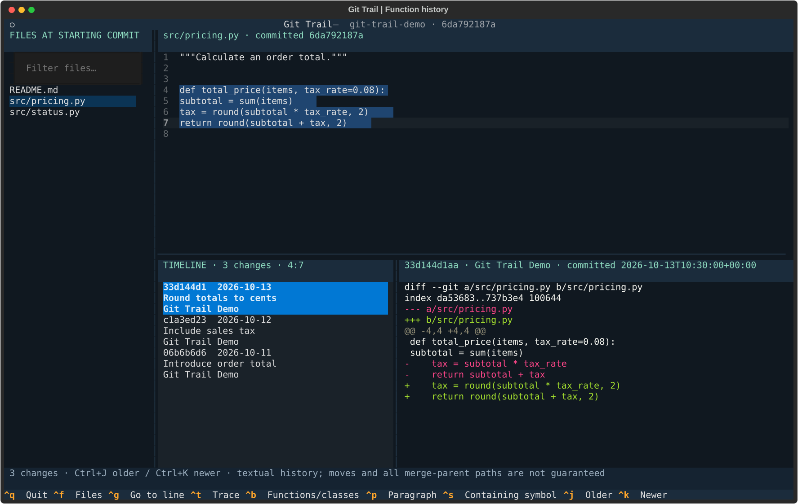
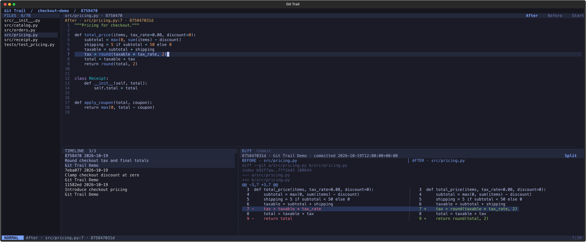
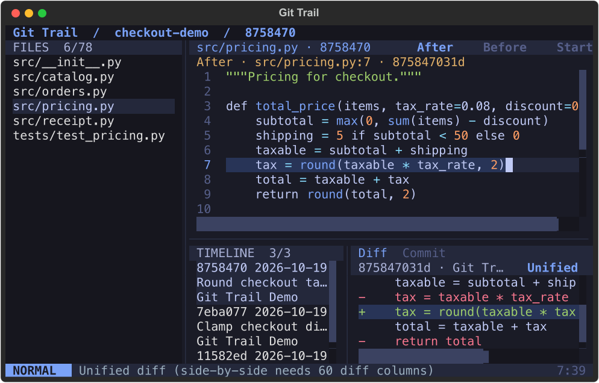
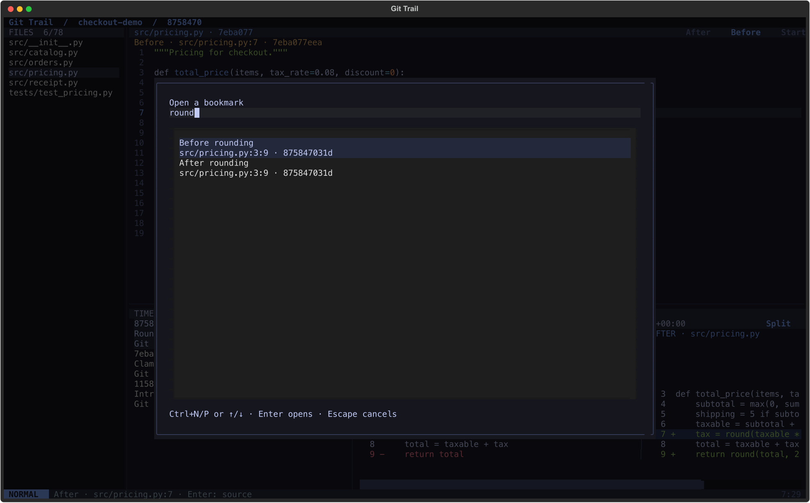

# Git Trail

A terminal app for answering: **when did this part of the file change?**

Select a line, several lines, a paragraph, a function, or a class. Browse the commits
that changed that selection, see the source at each revision, and inspect its diff.
Search code, filter history, and read the full commit context without leaving your terminal.
Follow whole symbols through refactors, bookmark exact revisions, and resume
your last session with saved layout, search options, and custom normal-mode keys.
Compare changes side by side and jump from a diff row to its exact historical source.



## Run from source

Requires Git, Python 3.10+, and [uv](https://docs.astral.sh/uv/).

```sh
cd /path/to/git-trail
uv venv .venv
uv pip install --python .venv/bin/python --only-binary :all: \
  'textual==8.2.8' 'tree-sitter==0.25.2' 'tree-sitter-language-pack==0.10.0'
./git-trail /path/to/repository
```

The local launcher runs Python source directly; no packaging build is required.
Add this directory to PATH, or create a symlink to the launcher, to use `git-trail`
from anywhere.

```sh
./git-trail /path/to/repository src/player.py --lines 42
./git-trail /path/to/repository src/player.py --lines 10:35
./git-trail /path/to/repository src/player.py --symbol Player
./git-trail /path/to/repository README.md --paragraph 12
./git-trail /path/to/repository src/player.py --text 'return cached_value'
./git-trail /path/to/repository src/player.py --text 'return None' --occurrence 2
./git-trail /path/to/repository src/player.py --ref v1.2.0 --lines 10:35
```

Paths are relative to the repository root. Absolute paths inside the repository
also work. Filenames containing spaces or shell characters must be quoted as usual.
With no arguments, the current directory is the repository.

## In the terminal

The interface uses an editor layout: slim pane headers, a shared dark palette,
and a single statusline. Searches and filters open a borderless, one-row prompt
at the bottom. Escape closes it and returns to the pane you were using.

The scrollable sidebar searches files at your starting commit. Drag its right edge
to adjust its width, focus the divider and use Left/Right, or press
Ctrl+Shift+Left/Right. F2 hides or shows the sidebar. Terminal resizing keeps the
source and history usable.

The source pane follows the selected change. **After** shows its committed source;
**Before** shows its first parent's source. The tracked lines are selected at their
historical coordinates. **Starting** returns to the source from which you traced
this timeline. Press F4 to cycle views. A file or selection that did not exist on
one side is labeled explicitly.

The lower panes show the filtered timeline and the selected range's diff.
The **Commit** tab includes the full message, author and commit dates, and changed
files. Ctrl+D switches between the diff and commit context. Tracing a selection in
historical source starts a new timeline from that displayed revision.
In compact terminals, the diff opens at the first changed hunk. Wider views
include the Git metadata. The original patch remains available in CLI output.
Click **Unified** or use `:split` to compare before and after in two columns.
The split view shows historical line numbers and keeps long lines scrollable.
It falls back to unified when the diff pane has fewer than 60 columns.
Use `:unified` to return to the default layout.

In the diff pane, `]c` / `[c` move between edit blocks, including separate edits
inside one large function hunk. F6 / Shift+F6 also work from other normal panes.
Use j / k, arrows, or gg / G to select a row; h / l scroll horizontally.
Click either column in a split diff to select that side. Enter opens the exact
historical filename and line: removed lines use the first parent, added lines
use the selected commit. Context lines support either side.
`:diffsource` opens the selected side; `:diffbefore` / `:diffafter` choose a side
explicitly. Headers, newline markers, and empty split cells have no source line.
Missing Git objects report an error and keep the current view.



Git Trail uses a read-only subset of Vim navigation. It does not run Neovim or
load Neovim plugins. Source starts in **NORMAL** mode; typing cannot edit files.

| Key in normal mode | Action |
| --- | --- |
| h / j / k / l | Move left / down / up / right in source |
| w / b | Next / previous word or punctuation group |
| 0 / $ | First / last character of the line |
| gg / G | First / last committed line |
| 3j / 2w / 42gg | Counted motions or go to a numbered line |
| v / V | Inclusive character / whole-line visual selection |
| Enter in source | Trace the current line or visual selection |
| Escape | Leave visual mode or close a prompt |
| / | Search source; filter files or history when that pane is focused |
| n / N | Next / previous source match, with the prompt closed |
| Ctrl+W then h / j / k / l | Move to the adjacent pane |
| Ctrl+W then w | Cycle files, source, timeline, and review |
| j / k / gg / G in lists | Navigate files or commits |
| j / k / gg / G in diff | Select a diff row |
| h / l in review | Scroll horizontally |
| ]c / [c in diff | Next / previous edit block, wrapping |
| Enter in diff | Open the selected historical source line |
| Space then f then f / s / h | Find files / symbols / history |
| : | Open the command prompt |
| ? / q | Help / quit |

Word motions group Unicode word characters and punctuation. Blank lines are
crossed to the next word. Arrow keys and mouse selection remain available;
using them leaves Vim visual mode and keeps the resulting selection.

The existing shortcuts also work:

| Key | Action |
| --- | --- |
| Ctrl+O | Focus file search; type a filter and press Enter to open |
| Ctrl+F | Find text or a function name in displayed code |
| F3 / Shift+F3 | Next / previous code match, wrapping at the ends |
| Ctrl+L | Focus the history filter |
| Ctrl+D | Switch between diff and commit context |
| F4 | Cycle After, Before, and Starting source views |
| F6 / Shift+F6 in normal mode | Next / previous diff edit block |
| Ctrl+Y | Copy the selected commit SHA through the terminal clipboard |
| Ctrl+Shift+Left / Right | Narrow / widen the sidebar |
| F2 | Hide / show the sidebar |
| F1 | Open the keyboard and filter guide |
| Shift+arrows or mouse drag | Select source text |
| Enter in source / Ctrl+T | Trace the current line or selected range |
| Ctrl+G | Go to a line number |
| Ctrl+P | Select the paragraph around the source cursor |
| Ctrl+B | Choose a parsed function or class |
| Ctrl+S | Select the smallest named symbol enclosing the source cursor |
| Ctrl+J / Ctrl+K | Older / newer change |
| Up / Down in timeline | Select a change and update its diff |
| Tab / Shift+Tab | Move between panes |
| Escape | Close find or a selection dialog |
| Ctrl+Q | Quit |

For a whole class, choose it with Ctrl+B. Ctrl+S inside a method selects that method.
The Ctrl+B picker also searches function and class names.
Paragraphs are contiguous nonblank lines. Arbitrary text selections track every
whole line touched by the selection.

## Search and filters

`/` or Ctrl+F opens find in the **displayed revision**. The match counter and
selection update as you type. Enter accepts the match and closes the prompt;
`n` / `N` or F3 / Shift+F3 navigate matches. Search is literal and ignores case
by default. Use `:set noignorecase` for case-sensitive search, `:set ignorecase`
to restore it, and `:set regex` / `:set noregex` to choose expression or literal
search. Invalid expressions show an error without tracing or editing source.



In file and history prompts or the symbol picker, Ctrl+N / Ctrl+P or Up / Down
move through results. Enter opens the highlighted item or accepts the filter.

File search accepts fuzzy path words and extension filters. Contiguous matches
rank ahead of scattered matches. Multiple `ext:` terms include any listed extension.

```text
player ext:py
src pricing ext:ts ext:tsx
```

History filters apply to the current selection's timeline. Plain words search the
subject, author, SHA, and selected-range patch. Combine these with:

```text
author:"Jane Doe" after:2026-01-01 before:2026-12-31
rounding author:Jane
hash:a1b2c3
```

Dates use each commit's recorded calendar date and include both endpoints.
All plain words and author terms must match. Clear the filter to restore every
change. Invalid filters show an explanation and preserve the last valid results.

The `:` prompt also accepts `help`, `q`, a line number such as `42`, `files`,
`file src ext:py`, `symbols`, `filter author:Jane`, `after`, `before`, `starting`,
`diff`, `commit`, `sidebar`, `split`, `unified`, `nextchange`, `prevchange`,
`diffsource`, `diffbefore`, and `diffafter`. `:filter` clears the history filter. Commands
only change the view; Git Trail keeps the repository read-only.

Layout width/visibility and search case/regex settings are saved on exit. Use
`:map x symbols` to assign an unused printable normal-mode key, `:unmap x`
to remove it, and `:maps` to see mappings. Built-in Vim keys remain reserved.
Diff actions `nextchange`, `prevchange`, and `diffsource` can also be mapped.
Mappings are inactive in prompts, dialogs, and visual selections.

Settings use a private, atomic `state.json` in `~/.config/git-trail` (or
`$XDG_CONFIG_HOME/git-trail`). `GIT_TRAIL_STATE_DIR` overrides the directory.
Keep it outside inspected repositories. Invalid settings are reported and
preserved for repair; save failures are shown when exiting.

Use `:bookmark NAME` to save the current source selection and history view,
`:open NAME` to restore it, and `:unbookmark NAME` to remove it. `:bookmarks`
opens a searchable picker with Ctrl+N/P and Enter. Names can contain spaces.
Each repository has its own bookmarks, with a limit of 100.



`:back` / `:forward` or Alt+Left / Alt+Right return to earlier/later visits.
`Space h b`, `Space h f`, and `Space h m` open Back, Forward, and Bookmarks.
The current run remembers up to 200 visits. Opening a new view after Back
replaces forward visits. These shortcuts stay inactive in prompts and dialogs.
Custom mappings also accept the actions `back`, `forward`, and `bookmarks`.

Bookmarks and the last session keep resolved commit IDs, source paths/ranges,
tracking mode, selected change, history filter, and Before/After/Starting view.
They restore the captured revision even after HEAD advances. Opening a repository
without a file resumes its last session. An explicit file, any explicit `--ref`,
or `--no-resume` opens the requested starting view instead. Missing objects or
invalid saved selections show an error and preserve the current view. Git Trail
does not replace a missing saved revision with HEAD.

## CLI output

```sh
./git-trail /path/to/repository src/player.py --symbols
./git-trail /path/to/repository src/player.py --symbols --json
./git-trail /path/to/repository src/player.py --lines 10:35 --json
```

JSON includes the resolved starting commit, selection, warnings, commit metadata,
patches, and old/new hunk coordinates. No TUI starts for these commands.
The CLI returns status 2 for invalid input or Git errors.

## What the history means

Git Trail uses Git's `log -L` range history, rather than just blaming the latest
version of a line. Earlier line numbers can change as lines are inserted or removed.
Unrelated edits are omitted. Git can follow simple file renames.

Selection always uses a **committed snapshot**, HEAD by default. Uncommitted changes
are excluded and called out. A historical `--ref` uses the file as it existed at
that commit, even if the working tree differs. Historical source views use the
path recorded in the range diff, including earlier paths across simple renames.

This is textual history. A copied, moved, split, or renamed function is not
guaranteed to retain its identity. Merge traversal follows Git's range-history
rules; it is not a complete exploration of every parent. Shallow clones may lack
older changes, and this is reported.

For a complete parsed function or class, use `:follow` in the TUI or opt in
from the CLI:

```sh
git-trail /path/to/repository src/pricing.py --symbol total_price --follow-symbol --json
```

Symbol history follows first parents through same-file renames and cross-file
moves. Same-path names with the same enclosing scope continue through body edits.
Other matches use name-normalized token bodies, preserving literals and operators.
Exact bodies or strong similarity can link a predecessor; the score is a heuristic,
not a probability or proof of semantic identity. Ordinary line history is unchanged.

Tied candidates, retained originals, weak matches, unreadable source, or scan limits
stop with a **partial history** warning. The Commit view includes tracking details.
Before/After show the actual old/new file and complete symbol range. Scans are
limited to 300 first-parent commits, 200 candidate files per transition, 2 MB per
file, 20 MB of historical source, 4,000 tokens per definition, and 45 seconds.
Split/merged definitions and cross-language refactors remain outside this mode.

The timeline shows commit dates. Author dates are also included in JSON. Git
does not record when a commit was pushed or first received by a remote repository.
Unusual control characters and Unicode line separators display as visible symbols;
line numbers follow Git's LF boundaries.

Functions and classes are selected using bundled Tree-sitter parsers. The initial
extension map supports Python, JavaScript/JSX, TypeScript/TSX, Rust, Go, Java,
C/C++, C#, Ruby, PHP, Swift, Kotlin, and Bash. Named declaration forms vary by
language. Unsupported forms or syntax errors require manual line selection.
Line, range, paragraph, and exact-text selection work for any nonempty UTF-8 text
file. Binary files are rejected.

Repository access is read-only. Git Trail does not fetch, clone, checkout, stage,
commit, or rewrite repository configuration. External diff, text conversion, and
optional index writes are disabled. Lazy fetching is disabled; the needed Git
objects must already be available locally.

## Development

```sh
uv pip install --python .venv/bin/python --only-binary :all: \
  'pytest==9.1.1' 'pytest-asyncio==1.4.0'
.venv/bin/python -m pytest -q
```

Tests create temporary local repositories and exercise real Git range history,
selectors, the CLI, and a headless Textual session. They do not use your
repositories or require network access.

Coverage includes the long-function parser regression, real range history,
mouse and keyboard scrolling/resizing, source search, combined filters,
historical source across renames, full commit context, bounded caches, stale
async results, conservative refactor matches, atomic settings, exact bookmark
and session restoration, and unchanged repository files and index.
Diff coverage includes split alignment, exact source coordinates, pruned objects,
mouse selection, Vim navigation, and interrupted source jumps.
